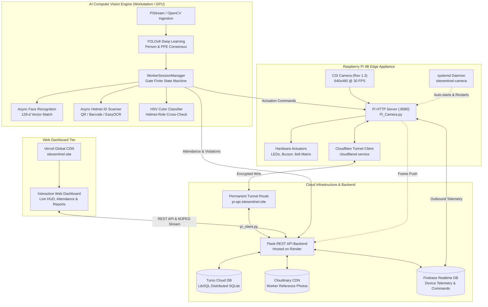
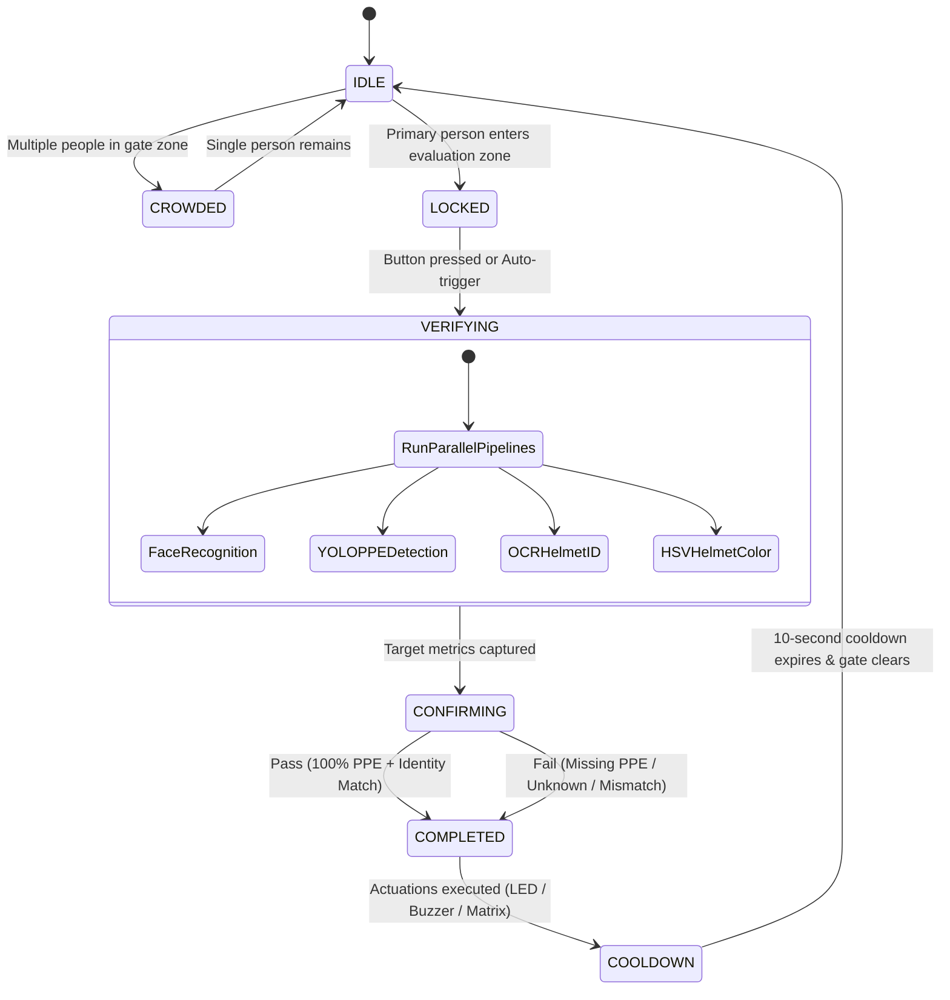

# SiteSentinel — Complete System Architecture & Project Handbook

> **Industrial-Grade Automated Gate Safety, Biometric Verification & IoT Actuation System**  
> *Author: SiteSentinel Engineering Team*

---

## 1. Executive Summary

**SiteSentinel** is an intelligent, automated safety gate enforcement and workforce management platform designed for construction, manufacturing, and industrial sites.

### The Problem It Solves
Industrial workplaces suffer from critical site management challenges:
1. **Safety Violations:** Workers entering hazardous zones without helmets or high-visibility safety vests, leading to severe injuries and regulatory penalties.
2. **Ghost Attendance & Buddy Punching:** Workers scanning badges or signing paper logs on behalf of absent colleagues.
3. **Role Mismatches:** Unqualified or non-credentialed workers assuming roles beyond their training (e.g. general laborers wearing supervisor helmets or entering specialized electrical/welding areas).
4. **Hardware Connectivity Roadblocks:** Traditional edge IoT installations break whenever the local router changes the device IP address, requiring complex networking and manual reconfigurations.

### The SiteSentinel Solution
SiteSentinel delivers an integrated, zero-trust edge gate appliance. In **under 2 seconds**, a worker standing at the gate is automatically verified through a synchronized multi-modal pipeline:
- **Biometric Identity:** 128-dimensional vectorized face recognition.
- **PPE Compliance:** Spatial anatomical YOLOv8 deep learning detection (Hardhat + Vest).
- **Helmet Gear Legitimacy:** OCR serial reading, QR code scanning, and barcode parsing.
- **Role-to-Gear Cross-Check:** Computer-vision HSV color classification matching helmet color to job role.
- **Edge Actuation:** Physical green/red LED indicators, active audio alarms, and an 8x8 LED matrix score display.
- **Autonomous Networking:** Permanent Cloudflare Named Tunnel (`pi-api.sitesentinel.site`) and headless `systemd` daemon auto-start on power-up.

---

## 2. High-Level System Architecture

SiteSentinel is architected as an event-driven, decoupled system across four physical and virtual tiers:



---

## 3. The Five Core AI & Computer Vision Subsystems

All computer vision inference runs in `interface/webcam_detection.py` and modular background workers to guarantee smooth 30 FPS video streaming without dropped frames.

### 3.1. Custom YOLOv8 PPE Deep Learning Detection
- **Model Weights:** Custom-trained YOLOv8 weights located in [`models/best.pt`](file:///e:/Hackathons/IEDC/SiteSentinel/models/best.pt).
- **Target Classes:** `Person`, `Hardhat`, `NO-Hardhat`, `Safety Vest`, `NO-Safety Vest`, `Safety Cone`, `Machinery`, `Vehicle`.
- **Anatomical Spatial Attribution:**
  To prevent false positives from safety gear lying on the floor or worn by workers in the background, detections are geometrically constrained:
  - **Head Zone:** Must fall within the top **40%** of the worker's bounding box.
  - **Torso Zone:** Must reside between **20% and 80%** of the worker's bounding box.
- **4-Frame Temporal Consensus:**
  Detections are buffered in a sliding window across 4 consecutive frames. If 3 unanimous readings occur, the system triggers an early decision lock, avoiding flicker and false alarms from temporary head turns.
- **PPE Scoring:**
  - **100% (Pass):** Both Hardhat and Safety Vest verified.
  - **50% (Partial):** Only one required safety item verified.
  - **0% (Violation):** Missing required safety gear.

---

### 3.2. Biometric Vectorized Face Recognition
- **Engine:** `dlib` 68-point facial landmark predictor + Deep ResNet 128-dimensional embedding model.
- **Vectorized In-Memory Comparison:**
  All enrolled worker face embeddings are preloaded as a NumPy matrix $(N \times 128)$. Recognition calculates vectorized Euclidean distance:
  $$\text{Distance} = \sqrt{\sum_{i=1}^{128} (x_i - y_i)^2}$$
  Matches are determined when the minimum Euclidean distance is strictly $\le 0.50$.
- **Hot-Reloading Biometrics ([`FaceDataManager`](file:///e:/Hackathons/IEDC/SiteSentinel/interface/face_data_manager.py)):**
  A background polling thread checks the cloud backend every 8 seconds. Whenever a manager enrolls or removes a worker on the dashboard, the in-memory face cache reloads instantly without restarting the video stream.

---

### 3.3. Multi-Engine Helmet Serial Verification (QR / Barcode / OCR)
Ensures workers wear their **assigned** safety equipment rather than swapping helmets:
1. **QR Code Engine:** `cv2.QRCodeDetector` parses high-density QR labels in $<2\text{ ms}$.
2. **Barcode Engine:** `cv2.barcode.BarcodeDetector` decodes standard linear Code-128 and EAN barcodes.
3. **GPU-Accelerated EasyOCR:**
   A multi-pass image preprocessing pipeline handles dirty, angled, or scuffed helmet labels:
   - **Pass 1:** Direct raw cropped inference.
   - **Pass 2:** Grayscale conversion + CLAHE (Contrast Limited Adaptive Histogram Equalization) + $1.8\times$ bicubic upscaling.
   - **Pass 3:** Otsu adaptive binary thresholding.
- The decoded helmet ID (e.g. `H1`, `H-04`) is checked against the worker's assigned helmet serial in the database.

---

### 3.4. Real-Time HSV Helmet Color Classification & Role Cross-Check
Enforces the industrial safety helmet color hierarchy via [`interface/helmet_color_classifier.py`](file:///e:/Hackathons/IEDC/SiteSentinel/interface/helmet_color_classifier.py):

| Helmet Color | Official Designated Role | Hex Code |
|---|---|---|
| **Yellow** | Labourer / Heavy-Duty / Construction | `#eab308` |
| **White (+ Grey)** | Manager / Engineer / Supervisor / Visitor | `#f8fafc` |
| **Red** | Firefighter / Emergency Responder | `#ef4444` |
| **Brown** | Welder / High Heat Operations | `#78350f` |
| **Blue** | Electrician / Technical Specialist | `#3b82f6` |
| **Green** | Safety Officer | `#22c55e` |
| **Pink** | Female Worker / Specialized Personnel | `#ec4899` |

#### Extraction Technique:
The classifier isolates the upper dome of the detected hardhat (excluding rims, hair, and face skin), converts the pixels to the HSV (Hue, Saturation, Value) color space, and classifies the dominant color using predefined color bins.

#### Security Policy:
If a registered **Labourer** wears a **White** helmet, or an **Electrician** wears a **Yellow** helmet, the gate locks, triggers the audio buzzer, and logs a `HELMET_COLOR_MISMATCH` safety incident in the audit database.

---

### 3.5. Multi-Person Tracking & Gate Session FSM ([`WorkerSessionManager`](file:///e:/Hackathons/IEDC/SiteSentinel/interface/worker_session.py))



- **Gate Occupancy Lock:** Locks onto the closest approaching worker using centroid tracking; ignores pedestrians or workers passing by outside the gate perimeter.
- **Anti-Fraud Cooldown:** Imposes a mandatory 10-second cooldown per worker to prevent multiple rapid scans or ghost check-ins.

---

## 4. Raspberry Pi Edge Hardware & IoT Architecture

The gate hardware runs on a Raspberry Pi 4B executing [`Pi_Camera.py`](file:///e:/Hackathons/IEDC/SiteSentinel/Pi_Camera.py) connected to standard industrial indicators:

### 4.1. Hardware Pinout Table
| Physical Pin | BCM GPIO | Hardware Component | Function |
|---|---|---|---|
| **Pin 11** | `GPIO 17` | Green LED | Access Approved / Check-In |
| **Pin 13** | `GPIO 27` | Red LED | Access Denied / Check-Out / Locked |
| **Pin 12** | `GPIO 18` | Active Buzzer | Audible Safety Alarm (1.0s pulsed) |
| **Pin 15** | `GPIO 22` | Tactile Push Button | Physical Gate Verification Trigger (GND on Pin 14) |
| **Pins 19, 23, 24** | `SPI0` | MAX7219 8x8 LED Matrix | Real-time scrolling score display (`100%`, `50%`, `0% FAIL`) |
| **CSI Port** | Ribbon Cable | Pi Camera Rev 1.3 (OV5647) | 640x480 @ 30 FPS MJPEG Stream |

---

### 4.2. Embedded Software Capabilities ([`Pi_Camera.py`](file:///e:/Hackathons/IEDC/SiteSentinel/Pi_Camera.py))
1. **Threaded HTTP Server (:8080):** High-speed REST endpoints (`/checkin`, `/checkout`, `/on`, `/off`, `/ppe`, `/state`, `/button`, `/health`, `/status`, `/stream`).
2. **Dual-Channel Cloud Forwarder:**
   - **Outbound Video Pusher:** Asynchronously streams JPEG frames to Render (`/api/pi/frame/push`).
   - **Firebase Realtime Bridge:** Reports heartbeat, button presses, and accepts remote actuation commands over WebSockets.
3. **Application Authentication:** Uses `hmac.compare_digest` to validate the `X-SiteSentinel-Device-Key` header against `SITESENTINEL_DEVICE_API_KEY`.
4. **Resilient GPIO Initialization:** Auto-detects and frees busy GPIO pins on modern Debian Linux (`rpi-lgpio`), preventing startup crashes.

---

### 4.3. Headless Automatic Startup (`systemd` Service)
The Pi is configured with a system daemon named `sitesentinel-camera` located at `/etc/systemd/system/sitesentinel-camera.service`:

```ini
[Unit]
Description=SiteSentinel Camera & Edge Hardware Server
After=network.target

[Service]
Type=simple
User=pisite
WorkingDirectory=/home/pisite/Site
ExecStart=/usr/bin/python3 /home/pisite/Site/Pi_Camera.py
Restart=always
RestartSec=3
Environment=PYTHONUNBUFFERED=1

[Install]
WantedBy=multi-user.target
```

**Result:** The device is a plug-and-play appliance. Simply plugging in the power cord automatically initializes the camera, Cloudflare tunnel, Firebase telemetry, and GPIO actuation without requiring a display, keyboard, mouse, or manual SSH commands.

---

## 5. Networking Layer: Permanent Cloudflare Named Tunnel

Traditional Raspberry Pi projects break when the router assigns a new local IP address. SiteSentinel solves this permanently:

```
[ Raspberry Pi 4B ]
       │
       ▼ (localhost:8080)
[ cloudflared daemon ]
       │
       ▼ (Outbound Encrypted QUIC / TLS Tunnel)
[ Cloudflare Global Edge Network ]
       │
       ▼ (Permanent Hostname)
https://pi-api.sitesentinel.site
       │
       ▼ (Authenticated with X-SiteSentinel-Device-Key)
[ Render Hosted Backend / Workstation Engine ]
```

### Key Advantages:
- **Zero Local IP Dependency:** The hosted backend on Render communicates strictly with `https://pi-api.sitesentinel.site`. The Pi's local IP (`10.95.11.249` or `192.168.x.x`) can change without breaking communication.
- **Zero Inbound Port Forwarding:** No router firewall ports (such as port 80 or 8080) are opened to the public internet. All traffic flows over outbound connections established by `cloudflared`.
- **Dual Security Boundary:**
  1. *Network Perimeter:* Cloudflare Access Service Token (`CF-Access-Client-Id` & `CF-Access-Client-Secret`).
  2. *Application Boundary:* Cryptographic Device Key (`X-SiteSentinel-Device-Key`) verified via HMAC SHA-256.

---

## 6. Cloud Backend, Database & Storage Infrastructure

### 6.1. Flask Cloud Backend ([`backend/main.py`](file:///e:/Hackathons/IEDC/SiteSentinel/backend/main.py))
- **Deployment:** Hosted on **Render** as a Python 3.11 Web Service running Gunicorn with 8 async worker threads.
- **Security:** Bcrypt password hashing, session-based role authorization, and Google OAuth 2.0 integration.
- **Device Relay Controller:**
  Directs hardware actions (`checkin`, `checkout`, `buzzer`, `ppe`, `verify`) through [`backend/pi_client.py`](file:///e:/Hackathons/IEDC/SiteSentinel/backend/pi_client.py) via the permanent Cloudflare Tunnel, with transparent fallback to Firebase Cloud and local network HTTP.
- **Real-Time Video Relay:** Proxies the live annotated MJPEG stream (`/api/pi/stream`) and caches the latest frame snapshot (`/api/pi/frame/latest`).

---

### 6.2. Distributed Cloud Database (Turso LibSQL)
- **Engine:** Turso Cloud SQLite over HTTPS LibSQL pipeline (`backend/database.py`).
- **Core Tables:**
  - `users`: Manager credentials, Google OAuth tokens, and preferred device bindings.
  - `workers`: Worker profile records, roles, biometric embedding vector references, and on-site status (`is_on_site`).
  - `helmets`: Helmet asset registry, serial IDs, assigned colors, condition states (`Good`, `Damaged`), and worker assignments.
  - `attendance`: Immutable check-in and check-out ledger with timestamps, confidence scores, and attendance types.
  - `safety_events`: Audit log of safety violations (e.g. `MISSING_HARDHAT`, `MISSING_VEST`, `HELMET_COLOR_MISMATCH`, `UNAUTHORIZED_ENTRY`), logging PPE scores and worker IDs.

---

### 6.3. Media CDN (Cloudinary)
- Handles worker portrait photo uploads.
- Automatically generates optimized facial thumbnails and stores reference URLs in the Turso database for remote management.

---

### 6.4. Outbound Firebase Realtime Database
- Provides instantaneous bidirectional event synchronization between the Raspberry Pi and hosted cloud instances.
- Maintains live device heartbeat telemetry, uptime tracking, and real-time remote gate trigger actuation.

---

## 7. Web Management Dashboard ([`dashboard.html`](file:///e:/Hackathons/IEDC/SiteSentinel/dashboard.html))

The user-facing portal is served at **[https://sitesentinel.site](https://sitesentinel.site)** via Vercel CDN and Render backend:

```
┌────────────────────────────────────────────────────────────────────────┐
│  SITESENTINEL — SAFETY MANAGEMENT CONSOLE                              │
├──────────────────────────────────────┬─────────────────────────────────┤
│  LIVE GATE HUD VIDEO STREAM          │  GATE CONTROLS & DEVICE STATUS  │
│  ┌────────────────────────────────┐  │  • Status: ONLINE (Tunnel)      │
│  │ [LIVE] MODE: IDLE              │  │  • Latency: 42ms                │
│  │ FPS: 28.4 | Camera: Pi Cam 01  │  │  • Hostname: pi-api...          │
│  │                                │  │  [ Verify Gate (Trigger) ]      │
│  │                                │  │  [ Test Buzzer ] [ Test LEDs ]  │
│  └────────────────────────────────┘  │  [ Stream Watchdog: ACTIVE ]    │
├──────────────────────────────────────┴─────────────────────────────────┤
│  WORKFORCE DIRECTORY | ATTENDANCE LEDGER | SAFETY VIOLATION AUDIT LOG  │
│  • Enrolled Workers: 24   • On-Site: 18   • Compliance Rate: 96.4%     │
│  [ Export PDF Report ] [ Export CSV ] [ Register New Worker / Helmet ] │
└────────────────────────────────────────────────────────────────────────┘
```

### Dashboard Capabilities:
1. **Live Annotated Video HUD:** Displays worker bounding boxes, real-time PPE labels, identity badges, and mode banners with an automatic reconnect watchdog.
2. **Worker Management Modal:** Add and edit workers, upload photos, assign occupational roles, and link helmet serial IDs.
3. **Helmet Inventory Registry:** Monitor helmet physical conditions (`Good`, `Fair`, `Damaged`) and track color-to-role compliance.
4. **One-Click Audit Reporting:** Automatically compiles compliance histories and incident logs into downloadable PDF reports (using ReportLab) and CSV spreadsheets.
5. **Remote Hardware Diagnostics:** Remotely trigger the gate evaluation, test the buzzer, pulse the Green/Red LEDs, and benchmark latency across the permanent Cloudflare tunnel.

---

## 8. Operational Verification Lifecycle (Step-by-Step)

```
[1. Worker Approaches Gate]
Camera captures wide scene in MODE: IDLE.
Centroid tracker locks onto approaching worker.
HUD turns Amber -> MODE: VERIFYING.
             │
             ▼
[2. Parallel Inference Evaluation (Duration: 0.8s - 1.5s)]
├─ 128-d Face Match       -> Matched: "Rahul Sharma" (Role: Construction Labourer)
├─ YOLOv8 PPE Consensus   -> Hardhat: YES (Head Zone) | Vest: YES (Torso Zone)
├─ OCR / QR Helmet Serial -> Serial scanned: "H-12" (Matches Database)
└─ HSV Helmet Color Check -> Color: Yellow (Complies with Labourer role)
             │
             ▼
[3. Decision Gate Execution]
             ├─────────────────────────────────────────────────┐
             │ PASS (100% Score)                               │ FAIL (Score < 100% or Mismatch)
             ▼                                                 ▼
- Gate unlatches                                  - Gate stays firmly LOCKED
- Green LED pulses ON (GPIO 17) for 3s            - Red LED pulses ON (GPIO 27) for 3s
- Matrix displays scrolling " 100% "              - Buzzer sounds continuous warning (GPIO 18)
- Attendance DB: Logged "Check-In"                - Matrix displays " 0% FAIL "
- HUD turns Green -> MODE: COMPLETED              - Safety DB: Logged violation event
             │                                                 │
             └────────────────────────┬────────────────────────┘
                                      │
                                      ▼
[4. Cooldown & Reset]
HUD turns Blue -> MODE: COOLDOWN (10-second timer).
Duplicate scans are blocked.
System cleanly returns to MODE: IDLE for the next incoming worker.
```

---

## 9. Developer & Deployment Quickstart

### 9.1. Local Workstation Setup
```bash
# Clone the repository
git clone https://github.com/Souvagya06/SiteSentinel.git
cd SiteSentinel

# Create and activate Python virtual environment
python -m venv .venv
source .venv/bin/activate  # On Windows: .venv\Scripts\activate

# Install workstation dependencies (including PyTorch & YOLOv8)
pip install -r requirements_local.txt

# Run the AI CV engine
python interface/webcam_detection.py --user-id 1 --imgsz 416
```

### 9.2. Raspberry Pi Setup
```bash
# Connect to the Pi via SSH
ssh pisite@10.95.11.249

# Verify systemd service status
sudo systemctl status sitesentinel-camera

# Verify Cloudflare tunnel health
sudo systemctl status cloudflared

# Inspect real-time hardware and camera logs
sudo journalctl -u sitesentinel-camera -f
```

---

## 10. Summary Matrix of Technologies

| Layer | Technologies Used |
|---|---|
| **Computer Vision & AI** | PyTorch, Ultralytics YOLOv8, OpenCV 4.10, dlib, EasyOCR, NumPy, SciPy |
| **Edge Hardware** | Raspberry Pi 4B, Pi Camera Module Rev 1.3 (OV5647), MAX7219 8x8 SPI Matrix, BCM GPIO, active buzzer, LEDs |
| **Edge Operating System** | Debian GNU/Linux 12 (arm64), systemd service management |
| **Networking & Security** | Cloudflare Named Tunnel (`cloudflared`), Cloudflare Access, HMAC SHA-256 device keys, TLS 1.3 |
| **Backend & Cloud Services** | Python 3.11, Flask 3.1, Gunicorn, Render PaaS, Vercel CDN |
| **Database & Telemetry** | Turso Cloud SQLite (LibSQL Pipeline), Firebase Realtime Database, Cloudinary Media CDN |
| **Frontend UI** | HTML5, CSS3 Glassmorphism, Vanilla ES6 JavaScript, Google Material Symbols, Chart.js, ReportLab PDF |
